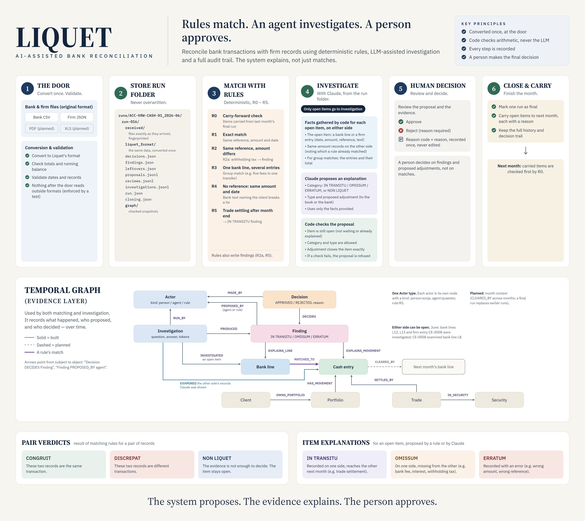

# Liquet [](https://github.com/sonjba/Liquet/actions/workflows/tests.yml)

**AI-assisted monthly bank reconciliation: rules match, an agent explains the rest, a person approves.**

*Liquet - Latin for "it is clear."*

Built in Python, with a temporal graph in [Raphtory](https://github.com/Pometry/Raphtory).



---

## Project Description

### The problem

Every month, a business has to reconcile its own cash records against its bank statement.

Most transactions match automatically. The remaining differences have to be investigated and explained, which can be slow, repetitive, and difficult to trace.

### The constraint

The records come from different sources and in different formats.

A reconciliation result also needs to be explainable: an accountant or auditor should be able to see **what was decided, why it was decided, and what evidence supports it.**

### The approach

Liquet separates deterministic matching from investigation.

1. **Rules** match records where the evidence is clear.
2. A **graph layer** connects records to their matches, explanations, related transactions, and history across months.
3. An **AI agent** investigates unresolved differences using a small set of controlled tools.
4. A **person approves** the proposed explanation or correction.
5. Every decision and its evidence is recorded.

The system is designed around three pair-level verdicts:

- **CONGRUIT** — enough evidence that the two records represent the same transaction.
- **DISCREPAT** — enough evidence that the two records are different.
- **NON LIQUET** — the evidence is insufficient to establish either conclusion; a person decides.

Importantly, **"no match was found" is not the same as "the records are different."**  
A `DISCREPAT` verdict requires evidence supporting the difference.

---

## Example Question

> **"Why doesn't our cash book agree with the bank statement for June?"**

Liquet works backwards from the unexplained difference and gathers the evidence needed to explain it.

---

## How It Works

### 1. Import, once

The bank statement and the firm's records arrive in their own formats. Liquet turns them into its own format **once**, at the door, checks them, and stores both: the files exactly as they arrived, and the same data in Liquet's format. From that point on, nothing in Liquet reads anything else.

A new bank or a new firm system means a new reader and mapping at the door, and no change anywhere else. A test fails if any later part of the code reaches back into the door.

### 2. Match

Deterministic rules identify transactions that agree on defined criteria, strictest first: same reference and amount, same reference with a difference, one bank line for several entries, matching without a reference, and settlements still in transit at month end.

### 3. Connect

The graph layer links transactions to:

- their corresponding records;
- related records;
- explanations;
- previous and subsequent months;
- reconciliation history.

### 4. Investigate

The AI agent investigates remaining differences using controlled tools and the available evidence.

It can propose an explanation and, where appropriate, a correcting entry.

### 5. Approve

A person reviews the evidence and approves or rejects the proposed resolution.

The agent does not directly change the accounting records.

### 6. Record

Every step is logged so that the reconciliation can be reviewed later.

### 7. Learn Across Months

The following month, Liquet checks whether expected timing differences have actually cleared.

---

## The Pipeline

Each run of a month goes through the same stages, in the same order, and each stage uses only what the stages before it produced:

```
bank files ─► bank reader + mapping ─┐
                                     ├─► store ─► prepare ─► match ─► check ─► save ─► graph
firm files ─► firm connector + mapping ┘
            (the door: the only code that knows outside formats)
```

Every run gets its own folder, and nothing in it is ever changed or overwritten. Running a month again makes a new folder next to the first:

```
runs/ACC-KRW-CASH-01_2026-06/run-001/
  received/   the files exactly as they arrived, with fingerprints
  liquet_format/  the same data in Liquet's format: what matching and the graph use
  decisions.json, findings.json, leftovers.json
  run.json    when it ran, from which files, which stages ran
  graph/      checked snapshots of the graph
```

Matching runs on the data read back from `liquet_format/`, so what is stored is exactly what was used. The graph is rebuilt from the run folder alone, so a June run still shows what Liquet saw in June, even if a mapping changes next year.

More detail: [`docs/pipeline.md`](docs/pipeline.md).

---

## Two Phases

Liquet runs in two phases that work differently.

**Phase 1 — Matching (a fixed pipeline).** Import, store, prepare, match, check, save.
The order never changes, nothing loops back, and the same input always gives the same result.
This is the part described above.

**Phase 2 — Investigation.** What the rules could not settle goes to the agent, Quaestor.
Today that is one call to Claude per open item. Code gathers the facts about the item
first: what the other side has for the same amount, which of those records a rule has
already matched to someone else, and, for a group match with a difference, the entries
inside it and their total. Claude answers in a fixed form: an explanation, or `NON LIQUET`
with what would settle it. Code then checks the answer before it is saved as a proposal.
The adjustment has to close the item exactly, or the proposal is refused.

The next step is a loop for what that first call can't explain. The agent gets a small
menu of tested tools, picks one, reads the result and decides what to look at next.
The steps can't be drawn in advance, because each one depends on what the last one found.

Two rules keep it safe:

- **It is bounded.** There will be a limit on tool calls per investigation. If the limit
  is reached without enough evidence, the answer is `NON LIQUET` and a person decides.
- **The record never loops.** Every proposal, decision and call to Claude is a new line
  added to the run's logs, never an edit. The process can go round; the history only
  moves forward.

---

## Why a Temporal Graph (Raphtory)

A reconciliation is a story in time. Money moves on one day, the bank shows it on another, Liquet decides on a third, and a person approves later still. A plain table keeps the latest state. I wanted the graph to keep **when** each thing became true.

So every record and decision in Liquet's graph is added at its own time:

- a cash entry at the date the money moved;
- a bank line at the date the bank shows;
- a trade's settlement at its settlement date;
- a decision or finding at the moment Liquet made it.

That lets the graph answer questions a table can't answer directly:

- "What did we know at the end of June?" → `g.before("2026-07-01")`
- "Which entries fall in the first half of the month?" → `g.window("2026-06-01", "2026-06-16")`
- "Whose money is this?" → entry → portfolio → client, in one walk

For June, after the rules, the graph has 54 nodes and 94 edges: clients, portfolios, the
account, securities, trades, cash entries, the bank statement and its lines, the findings,
and who proposed them, joined by ownership, settlement, match and explanation edges.
After Claude's investigation and a person's review it has 68 nodes and 130 edges. Each
call to Claude is an `Investigation` node, linked to the item it was about, the records
it was shown, and the proposal it led to. A `NON LIQUET` stays in the graph too, as an
investigation that led to nothing. Each decision links to what it decided and the person
who made it. The agent proposes, but it never appears as the one who decided.

**Something I found along the way.** In my tests on Raphtory 0.17.0, saving a graph with `save_to_file` dropped `Decimal` properties without any error, which for money is the worst kind of failure. Parquet (`to_parquet` / `from_parquet`) kept them. So Liquet saves snapshots as Parquet, loads each one straight back, and compares it with the original before it counts as saved. A snapshot that loses anything stops the save.

To see the graph, run `show_graph.py` on a run folder (it uses pyvis). It writes a `graph.html` you can open in a browser.

---

## Reconciliation Outcomes

At the **transaction-pair level**:

| Verdict | Meaning |
|---|---|
| `CONGRUIT` | Evidence supports that the two records are the same transaction |
| `DISCREPAT` | Evidence supports that the two records are different |
| `NON LIQUET` | Evidence is insufficient; a person decides |

At the **monthly reconciliation level**:

| Outcome | Meaning |
|---|---|
| `MATCHED` | Records have been reconciled |
| `EXPLAINED DIFFERENCE` | The difference has an identified explanation |
| `UNRESOLVED` | The available evidence does not establish an explanation |

Every verdict carries its supporting evidence.

---

## What It Tests

Liquet explores whether an AI agent is more reliable and easier to trace when it investigates reconciliation differences through a structured graph layer rather than working directly from raw records.

The system will be evaluated using **synthetic financial data containing known differences**, including timing differences, omissions, and errors.

The aim is not simply to ask whether the agent gets the answer right.

It is to examine:

- whether the agent reaches the correct explanation;
- whether the evidence supports its conclusion;
- whether the reasoning can be traced;
- when the agent correctly refuses to conclude;
- and whether the graph provides useful context for investigation.

### First result

On the June fixture, which has six known breaks, the rules explain two (a withholding tax
and a trade settling after the month). Claude, with one call per open item, proposes the
right explanation for three more: an unbooked custody fee, unbooked interest, and a
management fee recorded as 473.50 instead of 437.50. For the last one, a subscription
that only reaches the bank on 1 July, it answers `NON LIQUET`. That's correct: June's data
can't explain it, and Claude asked for the next month's statement.

**RIGHT 5, WRONG 0, OPEN 1**, in a fresh run, scored by code against the answer key
(`score.py`). The agent never sees the answer key. One run on data I built myself shows
the method works. It doesn't show it works on real data.

---

## Why It Can Be Trusted

Liquet is designed around constrained automation rather than unrestricted AI decision-making.

- **Rules handle deterministic matches.**
- **The agent works through controlled tools.**
- **The agent cannot directly modify accounting records.**
- **Every verdict carries its evidence.**
- **`NON LIQUET` is an explicit and valid outcome.**
- **A person approves proposed resolutions.**
- **Every action is recorded in the audit trail.**

The system does not require the agent to always have an answer.

> **If the evidence is not sufficient, the correct answer is: `NON LIQUET`.**

---

# Dictionary

| Term | Latin meaning | Meaning in Liquet |
|---|---|---|
| **CONGRUIT** | "It agrees" | The two records represent the same transaction |
| **DISCREPAT** | "It differs" | There is sufficient evidence that the records are different |
| **NON LIQUET** | "It is not clear" | There is insufficient evidence; a person decides |
| **LIQUET** | "It is clear" | The reconciliation is fully explained; unreconciled amount is zero |
| **IN TRANSITU** | "In transit" | A timing difference expected to clear in a subsequent period |
| **OMISSUM** | "Something omitted" | A bank item missing from the cash book, or vice versa |
| **ERRATUM** | "An error" | An incorrect amount, date, reference, or other recorded value |
| **INDICIA** | "Signs / evidence" | Evidence attached to a verdict or explanation |
| **QUAESTOR** | Roman official associated with the treasury | The AI agent that investigates differences |
| **IUDEX** | "Judge" | The human reviewer who approves or rejects a proposed resolution |
| **NEXUS** | "Connection / bond" | The graph layer connecting records and their relationships |
| **ACTA** | "Records / proceedings" | The audit log recording the reconciliation process |

---

## Design Principle

Liquet does not replace the person responsible for the reconciliation.

It separates three things:

**Rules determine what can be established deterministically.**

**The agent investigates what remains.**

**The person decides when the evidence is insufficient.**

> **The system proposes. The evidence explains. The person approves.**

---

## Status

Built so far:

- **Closing a month.** One run per month is marked final by a person, and what is still open
  is carried into the next month, each item with a reason (`close_month.py`).
- **Carry-forward and R0.** The next month starts from what the last one carried; R0 clears a
  carried item when its bank line arrives, and flags it if it arrived late. A July fixture
  tests this end to end.
- **Run identity.** Every run, investigation and closing records the Liquet version and the
  git commit that produced it.
- **One command.** `liquet run`, `liquet investigate`, `liquet decide`, `liquet close` and more;
  settings come from the environment (`LIQUET_RUNS_DIR`, `LIQUET_MODEL`).
- **CI.** The tests run on Linux and Windows on every push.

Next: remodelling the graph as a context graph that spans months (every judgement with who,
why, on what evidence and under which rule), then the tool loop for what one call can't
explain. The plan is in [`docs/later.md`](docs/later.md).

---

## Running It

Needs Python 3.11 or newer (Raphtory requires it).

```bash
python -m venv .venv
# Windows: .venv\Scripts\activate    macOS/Linux: source .venv/bin/activate
pip install -e ".[dev]"

pytest -q
python scripts/whole_loop.py
```

`whole_loop.py` runs June from start to finish, through the same `liquet` commands a person
types: the rules, Claude's investigation, the graph after each stage, a person's decisions
(a demo), and the score. By default it replays Claude's real answers from an earlier run, so
it needs no API key and costs nothing.

Type `liquet` to see every command, and `liquet <command> --help` for its options. Settings
come from the environment or a `.env` file (see `.env.example`; `.env` is never committed):
`LIQUET_RUNS_DIR` (default `runs`) and `LIQUET_MODEL`. To ask Claude for real, add your
`ANTHROPIC_API_KEY` there and run `python scripts/whole_loop.py --live`. It stops before the
decisions, because a person makes those.

---

## Data

All data in this repository is synthetic. No real company, client or bank data is used.

- The firm (Kestrel Row Wealth Ltd), its custodian (Northgate Custody Bank),
  clients and securities are invented. Any resemblance to real firms or people
  is coincidental. See `tests/firm-profile.md`.
- The firm profile, the June statement (`tests/fixtures/2026-06/`) and the
  test cases (`tests/fixtures/cases/`) were generated with help from an AI
  assistant (Claude) and checked by me.
- `tests/fixtures/2026-06/claude_answers.jsonl` holds Claude's real answers from one run,
  so the loop and tests can replay them without calling the API.

## Credits

- [Raphtory](https://github.com/Pometry/Raphtory) by Pometry, for the temporal graph.
- The continuity check between statements follows the idea of `verify_continuity`
  in [bankstatementparser](https://github.com/sebastienrousseau/bankstatementparser)
  by Sebastien Rousseau. Liquet compares balances to the penny, with no tolerance.

## AI assistance

I used Claude during development for design discussions, code review and some
code suggestions. I reviewed and tested all code, and I'm responsible for the
design decisions and the final result.

## Future work

The next steps (closing a month, timing rules across months, a calendar connector, the
tool loop) are planned in [`docs/later.md`](docs/later.md). The ideas below are further out.
None of these are built yet.

**Learning from repeated investigations**
Every agent run is logged: the question, the tools called with their inputs, and the result.
Over time, that log shows which investigations repeat. Frequent ones can be turned into named
**recipes**: fixed sequences of tested tools with parameters (for example, account and month).
A simple router then recognises the question and runs the recipe directly, with no LLM call,
or only a small one to word the explanation. Two safeguards apply:
- a cached result is never reused if the underlying data has changed since
- recipes reuse *how* to investigate, never a previous verdict

**Rule proposer**
When the agent explains the same kind of difference repeatedly (for example, an overseas dividend
arriving net of withholding tax), it proposes a new deterministic matching rule. A person approves
it, and from then on the rules engine handles it without AI. The aim is for the AI's role to shrink
as its findings become tested rules.

**Faster graph updates**
Today each run's graph is rebuilt from its folder. Later: load the latest snapshot and add only
the new events, with tests that the result equals a full rebuild.

**More input formats**
PDF, Excel, MT940 and camt.053 statements, each through its own reader at the door, producing the
same Liquet statement. PDF reading would use an LLM, with the existing self-checks (totals, running
balance, dates) verifying what it read.

**More data sources**
A relational-database connector alongside the document-database one, returning the same
canonical format.

**Question front door**
Plain-language questions ("Which May items are still in transit?") answered by calling the
same tested tools.

**Broader reconciliation**
Several accounts and currencies, continuity checks across every month in a run, and
reconciliation of holdings as well as cash.